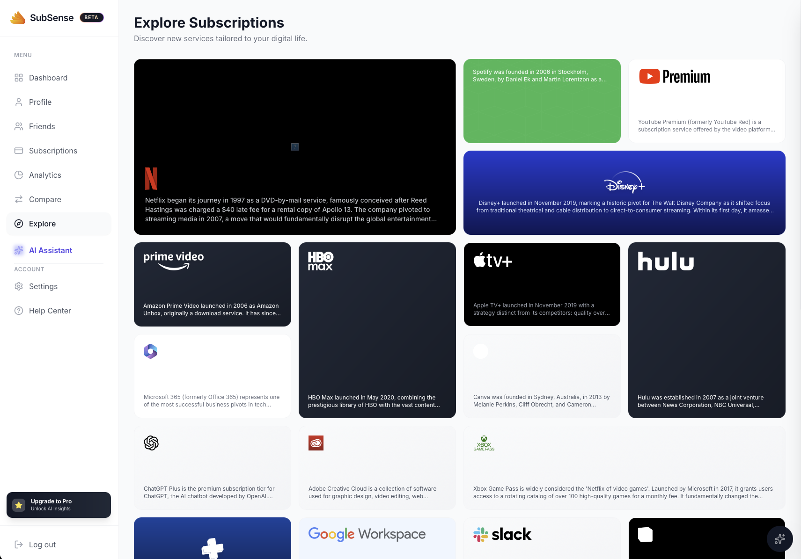
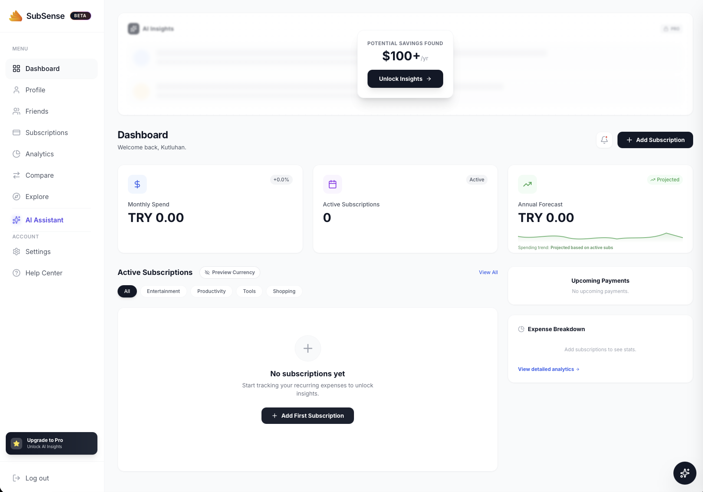
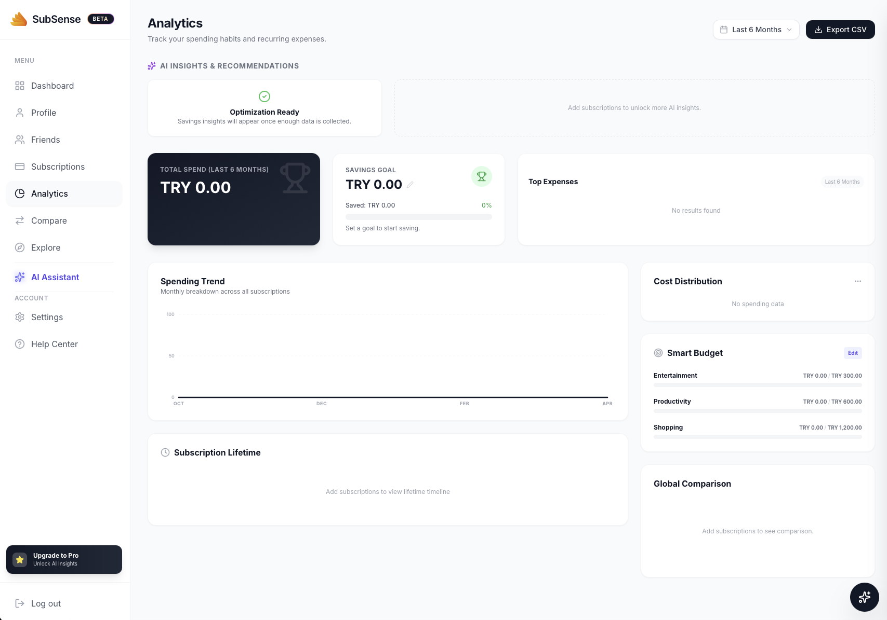

<div align="center">

<br />


<br /><br />

# **Aboneyim**

### **Akıllı abonelik takipçisi** — Yapay zekâ destekli harcama analizi ve tasarruf önerileri.

[Live Demo](https://sub-sense-ashy.vercel.app) · [Report Bug](https://github.com/kutluhangil/SubSense/issues) · [Request Feature](https://github.com/kutluhangil/SubSense/issues)

</div>

---

## 🇹🇷 Türkçe Açıklama

**Aboneyim**, dijital aboneliklerinizi tek bir akıllı panelden ücretsiz yönetmenizi sağlayan modern bir takip uygulamasıdır. Google Gemini yapay zekası ile gereksiz harcamalarınızı tespit eder, 20'den fazla döviz birimini anlık olarak çevirir, ortak abonelikleri bölüştürür ve global fiyatlarla karşılaştırarak size özel tasarruf fırsatları sunar.

---

## ✦ What is Aboneyim?

**Aboneyim** is an AI-powered subscription manager that gives you a complete picture of every service draining your wallet — instantly and 100% free. Add a subscription, get deep insights.

No spreadsheets. No guessing. Just real numbers, in your real currency, with AI telling you exactly what to cancel.

---

## ⚡ Features

| Feature | Description |
|--------|-------------|
| 🧠 **Gemini AI Insights** | Detects redundant subscriptions, estimates monthly savings, personalized suggestions |
| 🌍 **20+ Currencies** | Real-time conversion to your base currency — always accurate totals |
| 📊 **Smart Analytics** | Category breakdowns, billing cycle views, and spending timelines |
| 🤝 **Split the Bill** | Track shared family/duo subscriptions using only your personal share |
| 📅 **Calendar & CSV Sync** | Live ICS calendar feed for Google/Apple/Outlook + CSV import & export |
| 🔍 **Global Price Compare** | See if you're overpaying vs. worldwide averages for top services |
| 🔔 **Budget & Trial Alerts** | Notifications before renewals, free trial expirations, or budget limits |
| 🎨 **Premium UI** | Glassmorphic, dark-mode ready, Framer Motion animations |
| 🔒 **Privacy First** | Your data stays in your Firebase — never sold, never shared |

---

## 🖼️ Screenshots

<div align="center">

| | |
|:---:|:---:|
|  |  |
| **Landing** — Hero & feature preview | **Explore** — Discover new services |
|  |  |
| **Dashboard** — Manage every subscription | **Analytics** — Real spending insights |

</div>

---

## 🛠️ Tech Stack

```
Frontend          →  React 19 · TypeScript · Vite 6 · TailwindCSS · Framer Motion
Backend           →  Firebase Auth · Firestore · Cloud Functions (Node + Express)
AI                →  Google Gemini 2.0 Flash (via Cloud Functions Proxy)
Email             →  Resend via Cloud Functions
Icons             →  Lucide React
Deployment        →  Docker + Nginx (macmini-server / Tailscale) · Vercel
```

---

## 🚀 Getting Started

### Prerequisites

- Node.js `>= 18`
- A Firebase project with **Auth** and **Firestore** enabled

### Local Development

```bash
# Clone the repository
git clone https://github.com/kutluhangil/SubSense.git
cd SubSense

# Install dependencies
npm install

# Configure environment
cp .env.example .env
# → Fill in your Firebase keys (see below)

# Start the dev server (runs on http://localhost:5173)
npm run dev
```

### Environment Variables

| Variable | Description | Required |
|----------|-------------|----------|
| `VITE_FIREBASE_API_KEY` | Firebase Web API Key | ✅ |
| `VITE_FIREBASE_AUTH_DOMAIN` | Firebase Auth Domain | ✅ |
| `VITE_FIREBASE_PROJECT_ID` | Firebase Project ID | ✅ |
| `VITE_FIREBASE_STORAGE_BUCKET` | Firebase Storage Bucket | ✅ |
| `VITE_FIREBASE_MESSAGING_SENDER_ID` | Firebase Sender ID | ✅ |
| `VITE_FIREBASE_APP_ID` | Firebase App ID | ✅ |

---

## ☁️ Deployment

### Self-Hosted (`macmini-server` — Docker + Nginx + Tailscale Serve)

```bash
# From Mac (builds on remote Intel macmini-server and binds to 127.0.0.1:3002)
docker --context macmini compose -f server/docker-compose.yml --env-file .env up -d --build
```

Serves on `127.0.0.1:3002` inside the server and is published exclusively to the Tailscale tailnet via `tailscale serve`.

---

## 📐 Project Structure

```
SubSense/
├── components/           # React UI (Dashboard, Analytics, AI Assistant, …)
├── firebase/
│   └── firebase.ts       # Firebase initialization & singletons
├── functions/            # Cloud Functions (Node + Express)
│   └── src/
│       ├── index.ts      # Stripe + email handlers
│       └── app.ts        # Express API router
├── hooks/                # Custom React hooks (useAchievements, …)
├── utils/                # Core services
│   ├── gemini.ts         # Gemini AI integration
│   ├── currency.ts       # Multi-currency conversion
│   ├── firestore.ts      # Firestore data layer
│   └── stripe.ts         # Stripe client service
├── server/               # Self-hosting config
│   ├── Dockerfile        # Multi-stage build (Node → Nginx)
│   ├── docker-compose.yml
│   └── nginx/            # Nginx configs (SPA + proxy)
├── public/               # Static assets, brand logos
└── docs/
    └── screenshots/      # README screenshots
```

---

## 🔌 Core Services

| Service | Purpose |
|---------|---------|
| **`utils/gemini.ts`** | Builds sanitized payloads and calls the Gemini REST API for AI insights |
| **`utils/currency.ts`** | 20+ currency metadata and conversion logic |
| **`utils/firestore.ts`** | All Firestore reads/writes for subscriptions and profiles |
| **`utils/stripe.ts`** | Client-side Stripe session creation via Firebase Callable Functions |
| **`functions/src/index.ts`** | Server-side Stripe webhook handler, email sender, user search |

---

## 📊 How It Works

### AI Optimization Flow
1. User subscriptions are **validated** and **sanitized** (PII removed)
2. All prices **converted** to base currency for fair comparison
3. Sent to **Gemini 1.5 Flash** with a strict prompt schema
4. Response is parsed into typed `AIInsight` objects
5. Cached in memory for the session — no re-fetching

### Multi-Currency Engine
Every subscription keeps its original currency. Totals are computed on-the-fly using the user's selected base currency. Conversion rates are cached per session for performance.

### Privacy Model
All user data lives in **your own Firebase project** under Firestore rules. SubSense never sees, stores, or transmits subscription data outside your Firebase — except sanitized payloads sent to Gemini for AI analysis.

---

## 🗺️ Roadmap

| Status | Feature |
|:-:|---|
| ✅ | Core subscription tracking |
| ✅ | Multi-currency conversion (20+) |
| ✅ | Gemini AI optimization insights |
| ✅ | Analytics dashboard |
| ✅ | Stripe billing — Free & Pro tiers |
| ✅ | Explore & discover catalog |
| ✅ | Self-hosted Docker deployment |
| 🔄 | Friends & social sharing |
| 🔄 | Real-time exchange rates |
| ○ | React Native mobile app |
| ○ | CSV & Apple Wallet import |
| ○ | Renewal push notifications |

<sub>✅ Shipped &nbsp; · &nbsp; 🔄 In progress &nbsp; · &nbsp; ○ Planned</sub>

---

## 🤝 Contributing

Contributions are welcome! Feel free to open an issue or submit a pull request.

1. Fork the repository
2. Create your feature branch (`git checkout -b feature/amazing-feature`)
3. Commit your changes (`git commit -m 'feat: add amazing feature'`)
4. Push to the branch (`git push origin feature/amazing-feature`)
5. Open a Pull Request

---

## 📄 License

Distributed under the **MIT License**. See [`LICENSE`](LICENSE) for more information.

---

<div align="center">

<br />

Built with ❤️ by [**Kutluhan Gil**](https://github.com/kutluhangil)

<br />

*If you find this useful, consider giving it a ⭐*

<br />

</div>
