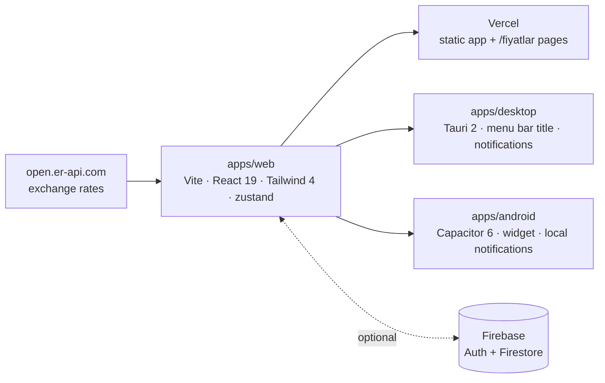

<div align="center">


<p>
  <a href="https://sub-sense-ashy.vercel.app"></a>
  <a href="https://sub-sense-ashy.vercel.app/fiyatlar"></a>
  
  
</p>

<p><em>A free subscription tracker: what you pay, when it renews and which price just went up.<br>
No ads, no paid tier, and it works without an account.</em></p>

</div>


## The idea

Recurring charges are easy to start and easy to forget. SubSense keeps them in one list and answers three questions every time you open it: **how much am I really paying per month and per year, what renews next, and did anything get more expensive?**

The same React interface runs in three places: in the browser, as a macOS app whose menu bar title shows your monthly total and the next renewal, and as an Android app with a home-screen widget. There is no server of its own. Your list lives on the device; sync through Firebase is something you switch on, not something you need.

> **A price change is a price change, not a currency move.** The price radar compares each plan's catalogue price in US dollars, which does not move with exchange rates. When the lira drops, your total in lira goes up, but SubSense will not tell you Netflix raised its price unless the plan itself did.


## Features

| | |
|---|---|
| **Overview** | Monthly and yearly totals in your base currency, upcoming charges and a category breakdown. |
| **Subscriptions** | Search, filter and edit every plan: price, billing cycle, currency, start date, next charge, status. |
| **Plan picker** | Pick a known service and plan and the price fills itself from the bundled price table, in Turkish or US pricing. |
| **Calendar** | A month view of renewals, day by day. |
| **Insights** | Category totals, a twelve-month projection and overlap checks: two or more music services, or several plans in one category, with the monthly saving from keeping only the cheapest. Shown only when the data actually says so. |
| **Budget alerts** | Set a limit per category in Insights; the overview flags the categories that are over it and by how much. |
| **Price radar** | Flags plans whose catalogue price went up since you last saw it, with a notification on Mac and Android. |
| **Discover** | Service profiles grouped by category, with current Turkish and US prices. |
| **Wrapped** | A year-in-review made to share: yearly total, top category, priciest plan, longest-running subscription and the peak month. |
| **`/fiyatlar` pages** | Static, SEO-friendly price pages for popular services, one per service plus a hub, written at build time. |
| **Reminders** | Local renewal notifications on Mac and Android. No push server. |
| **Live exchange rates** | Rates are fetched at start with a hard timeout, so the first paint never waits on the network. |
| **Backup** | Export your list and settings as JSON (share sheet, download or clipboard) and import it on another device. |
| **Optional sync** | Google sign-in with Firebase Auth and Firestore. Skip it and nothing leaves the device. |
| **Mac menu bar** | The Tauri shell sets the tray title, for example `₺1.240 · Spotify tomorrow`, whenever the totals change. |
| **Android widget** | A home-screen widget with this month's total and the next renewal. |
| **TR / EN, light and dark** | Device language is detected on first launch. |


## How the numbers stay honest

The logic is plain TypeScript under `apps/web/src/core/lib/`, covered by unit tests:

| Rule | Why |
|---|---|
| Price changes are measured on the plan's USD reference price, never on the converted lira amount. | A weaker lira would otherwise look like every service raising prices at once. |
| The first time a plan is seen, its price is stored silently. | A fresh install or a restored backup never fires a wall of fake "price went up" alerts. |
| Only increases above one cent are reported. | Rounding in the price table does not turn into notifications. |
| Inactive plans are left out of totals, insights, Wrapped and the radar. | A paused subscription should not inflate your monthly spend. |
| An overlap card appears only when there is a real overlap. | No filler tips: if there is nothing to save, the card is hidden. |
| The remote price catalogue is off by default. | There is no official price API for these services. The app uses its bundled table unless you point `PRICE_CATALOG_URL` at a JSON file you host (cached for 12 hours). |


## One UI, three shells



| Shell | What it adds |
|---|---|
| **Web** | The whole interface, the landing page and the build-time `/fiyatlar` pages, sitemap and robots. |
| **macOS** (`apps/desktop`) | A Tauri 2 app with a tray icon whose title the UI updates, plus native notifications. A Mac App Store build flag turns off Google sign-in there. |
| **Android** (`apps/android`) | A Capacitor 6 app with native Google sign-in, local notifications and the home-screen widget. |


## Pages

| Page | What it shows |
|---|---|
| Landing | What SubSense does, with a sign-in card and a wall of service logos |
| Overview | Totals, next charges, category bars, budget alerts |
| Subscriptions · Editor | The list and the add / edit sheet |
| Calendar | Renewals by day |
| Insights | Categories with budget limits, projection, overlaps |
| Discover | Services and their current prices |
| Wrapped | The year in review |
| Settings | Base currency, language, theme, backup, account |
| Legal | Privacy and terms |


## Türkçe özet

**SubSense**, ücretsiz bir abonelik takipçisi: ne ödediğini, ne zaman yenilendiğini ve hangi fiyatın arttığını gösteriyor. Reklam yok, ücretli sürüm yok, hesap açmadan da çalışıyor. Aynı arayüz web'de, Mac'te menü çubuğunda toplamı gösteren bir uygulama olarak ve Android'de ana ekran widget'ıyla çalışıyor. Fiyat radarı zammı planın dolar fiyatından ölçüyor, böylece kur artışı zam gibi görünmüyor. Takvim, kategori bütçeleri, çakışan abonelik uyarıları, yıllık "Wrapped" özeti, JSON yedek ve popüler servisler için `/fiyatlar` sayfaları var. Firebase ile eşitleme isteğe bağlı.


## Development

```sh
cd apps/web
npm install
npm run dev            # http://localhost:5180
npm test               # vitest: 12 suites (pricing, priceWatch, derive, format, notifications, rates…)
npm run build          # typecheck + build + /fiyatlar pages, sitemap, robots
npm run android:apk    # debug APK (JDK 17)
npm run android:aab    # release bundle
cd ../desktop && npm run build   # macOS app
```

Firebase config lives in the app; `.env.local` only carries build flags: `VITE_APPLE_SIGN_IN` (show Sign in with Apple) and `VITE_MAS` (Mac App Store build).

```
apps/web/src/core/   types, data (catalogue, price table, currencies), lib (pure logic), store (zustand)
apps/web/src/pages/  Overview, Subscriptions, Calendar, Insights, Discover, Wrapped, Settings…
apps/web/src/ui/     kit, navigation, liquid navbar, strings
apps/web/scripts/    price-pages.ts: the build-time /fiyatlar generator
apps/desktop/        macOS shell (Tauri 2)
apps/android/        Android shell (Capacitor 6) with the widget
docs/                plan, image prompts, marketing notes
```

Pushing to `main` deploys `apps/web` on Vercel. A security review workflow runs on pull requests.

<div align="center">
<br>
<a href="https://github.com/kutluhangil"></a>
<sub>Know what you pay. Keep what you save. · prices in the banner are examples.</sub>
</div>
