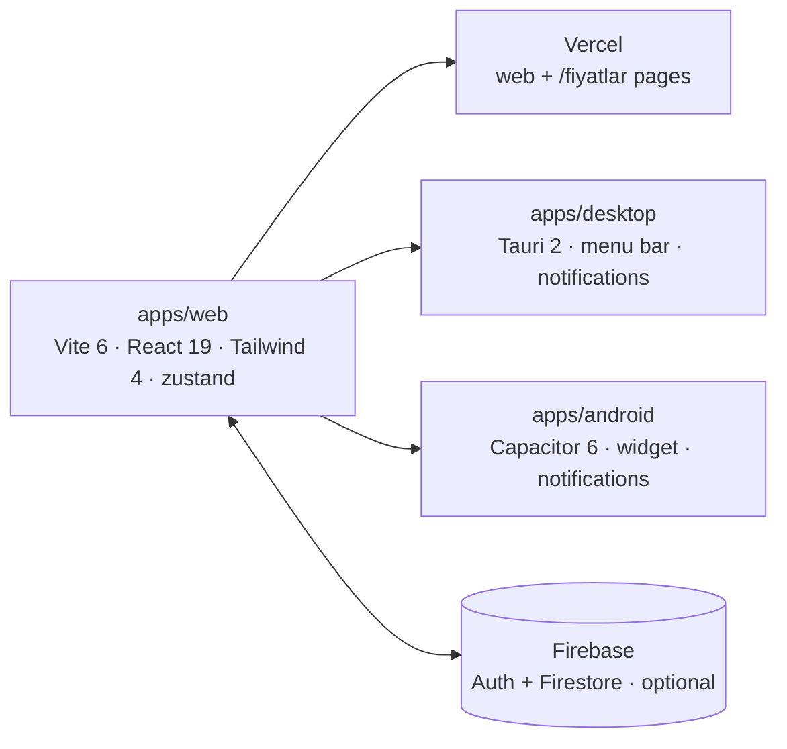

<div align="center">



<p>
  <a href="https://sub-sense-ashy.vercel.app"></a>
  <a href="https://sub-sense-ashy.vercel.app/fiyatlar"></a>
  
  
</p>

<p><em>A free subscription tracker: what you pay, when it renews and which price just went up.<br>
No ads, no paid tier, and it works without an account.</em></p>

</div>


## What it is

SubSense keeps every recurring charge in one place. It shows your real monthly and yearly spend, reminds you before renewals, and flags price increases so they never slip by quietly. The same interface runs on the web, as a macOS menu bar app and as an Android app.


## What's inside

| | |
|---|---|
| **Overview** | Monthly and yearly totals, upcoming charges and budget alerts at a glance. |
| **Subscriptions** | Search, filter and edit every plan with price, cycle, currency and next charge. |
| **Calendar** | A month view of renewals, day by day. |
| **Insights** | Category breakdowns and overlapping services you might not need. |
| **Discover** | Service profiles with current Turkish and US prices. |
| **Price radar** | Catalogue prices update automatically, and price hikes on your plans are highlighted. |
| **Wrapped** | A year-in-review of your subscriptions, made to share. |
| **/fiyatlar** | Static, SEO-friendly price pages for popular services, generated at build time. |
| **Reminders** | Local notifications on Mac and Android, no server needed. |
| **Sync, if you want it** | Optional Google sign-in with Firebase; skip it and everything stays on your device. |


## One UI, three shells



There is no server of its own: the web build is static, and data lives on the device or, when you opt in, in Firestore.


## Türkçe özet

**SubSense**, ücretsiz bir abonelik takipçisi: ne ödediğini, ne zaman yenilendiğini ve hangi fiyatın arttığını gösteriyor. Reklam yok, ücretli sürüm yok, hesap açmadan da çalışıyor. Aynı arayüz web'de, Mac'te menü çubuğu uygulaması olarak ve Android'de çalışıyor. Takvim, harcama analizleri, yıllık "Wrapped" özeti, otomatik güncellenen fiyat kataloğu ve popüler servisler için `/fiyatlar` sayfaları var.


## Development

```sh
cd apps/web
npm install
npm run dev            # http://localhost:5180
npm test               # vitest
npm run build          # typecheck + build + /fiyatlar pages, sitemap, robots
npm run android:apk    # debug APK
cd ../desktop && npm run build   # macOS app
```

```
apps/web/       the whole interface: pages, core data and store, UI kit
apps/desktop/   macOS shell (Tauri 2)
apps/android/   Android shell (Capacitor 6)
docs/           plan, image prompts, marketing notes
```

Pushing to `main` deploys `apps/web` on Vercel.

<div align="center">
<br>
<a href="https://github.com/kutluhangil"></a>
<sub>Know what you pay. Keep what you save.</sub>
</div>
